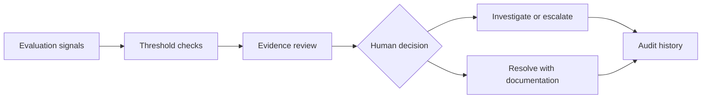

# ModelWatch ✨

**RAG quality evaluation, incident response, and human-in-the-loop review**

*A monitoring and review workflow for a support-oriented RAG assistant, connecting measurable quality changes to evidence-based investigation and human decisions.*

## 💗 Explore & inspect the work

**🎮 [Try the interactive ModelWatch dashboard](https://modelwatch-ai-prototype-msk.lovable.app/)**  
Select a scenario, inspect its alerts and supporting evidence, and explore reviewer decisions.

**💻 [Open the final Python/Jupyter notebook](./MSB_ModelWatch_Week5_FINAL.ipynb)**  
Inspect the evaluation workflow, code, and recorded outputs.

**🧪 [Explore the testing and validation notebook](./ModelWatch_Week5_MVP_v3_tests.ipynb)**  
See the test scenarios and validation checks.

**📊 [Explore the monitoring dashboard notebook](./ModelWatch_Week5_MVP_v4_dashboard.ipynb)**  
Follow the dashboard-focused iteration of the monitoring work.

*The notebooks contain the Python evaluation work; the linked dashboard presents a separate, interactive reviewer experience.*

## 💡 Why I built this

I kept coming back to a practical question: **how would a team recognize that an AI assistant's answers were getting less reliable when the responses still sounded convincing?** A support assistant can remain fast and fluent while retrieving less relevant evidence or attaching citations that no longer support its claims. Those changes matter to the people relying on the answers, and they can be hard for an operations team to diagnose from a single performance score.

I developed ModelWatch to explore how quality signals can guide investigation, what evidence a reviewer needs before reaching a conclusion, and how to document decisions when an alert requires human judgment.

## 🔍 What I evaluated and why it matters

| Evaluation signal | What it measures | Why it matters operationally |
| --- | --- | --- |
| **Retrieval success** | Whether the retrieval step returns relevant supporting information. | Fluent answers can still be based on weak or missing evidence. |
| **Citation mismatch** | Whether a cited source actually supports its corresponding claim. | Credible-looking citations can mislead people when the underlying evidence does not match. |
| **Customer satisfaction (CSAT)** | User-reported experience across the evaluation period. | Feedback reflects the user experience, but cannot independently identify a technical cause. |
| **p95 latency** | Response time at the 95th percentile. | Slower requests affect usability and may indicate a performance issue separate from answer quality. |
| **Data validity** | Whether monitoring observations are complete and logically consistent. | Invalid readings should be flagged before they trigger a misleading severity decision. |

I evaluate the signals **together**. A drop in retrieval success paired with more citation mismatches suggests investigating answer grounding. If latency stays steady, that helps narrow the immediate questions without claiming to know the cause. A metric change is evidence that something warrants attention, not proof of which component failed.

## 📊 Synthetic evaluation example

The evaluation compares a four-day baseline with a four-day comparison period for a support RAG assistant.

| Signal | Baseline | Comparison | Observed change |
| --- | ---: | ---: | ---: |
| CSAT | 82.8% | 73.8% | **−9.0 percentage points** |
| Retrieval success | 90.0% | 79.0% | **−11.0 percentage points** |
| Citation mismatch | 1.8% | 6.3% | **+4.5 percentage points** |
| p95 latency | 1.8 seconds | 1.8 seconds | **Unchanged** |

Under the demonstration's illustrative thresholds, the first three changes warrant a **HIGH-priority human review**. Unchanged p95 latency means the data does not show a concurrent deterioration in that response-time statistic.

**What the evidence shows:** lower satisfaction and retrieval success, alongside more citation mismatches.  
**What it cannot yet explain:** whether the model, prompts, source documents, retrieval index, or collection process changed. That question requires additional evidence before a reviewer can make a defensible diagnosis.

## 🧜‍♀️ Mermaid flowchart for system review and design

The review design connects an observed quality signal to a documented human decision. This is the original evaluation-to-audit flow, preserved as a Mermaid diagram.

**A threshold breach creates a reason to investigate.** It does not automatically establish a root cause, justify a model change, or close an incident. The interactive dashboard supports different monitoring scenarios, reviewer assignment, notes, decisions, and an audit-history view so those distinctions are visible rather than buried in a policy statement.

## 🧪 Testing and design decisions

- **Separate the signals.** Retrieval quality, source grounding, user experience, and responsiveness can change independently.
- **Validate before classifying.** Missing or inconsistent readings should be identified before calculating or communicating incident severity.
- **Investigate before diagnosing.** Keep observed changes distinct from plausible explanations and unverified root causes.
- **Give decisions an owner.** Higher-severity reviews need an identified reviewer, supporting evidence, and a recorded decision.
- **Make decisions traceable.** Review notes and an audit history allow someone else to reconstruct what was known and why the next action was chosen.

**How it comes together:** Python/Jupyter evaluation notebooks document the measurements and tests; the interactive dashboard explores how reviewers could use those signals to make and document operational decisions.

🔐 <strong>Technical scope.</strong> Evaluation data and thresholds are synthetic or illustrative. The interactive reviewer experience does not use live customer records, production LLM inference, or a connected incident-management system.

---

### 👩🏻‍💻 About the creator

**Maya K.**  
M.S. Artificial Intelligence Management, Georgetown University  
Washington, DC

[💗 Explore my other AI projects](https://github.com/msb24)
