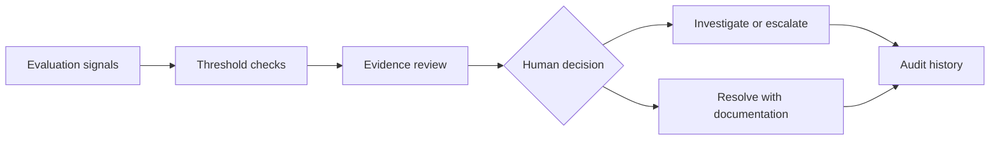

# ModelWatch ✨

**RAG quality evaluation, incident response, and human-in-the-loop review**

### 💻 Explore the project

**[✨ Try the interactive ModelWatch dashboard](https://modelwatch-ai-prototype-msk.lovable.app/)**  
**[📓 Inspect the Python evaluation notebook](./ModelWatch%20RAG%20Monitor.ipynb)**  
**[📊 Review the synthetic monitoring data](./modelwatch_monitoring_data.csv)**

## 💡 Why I built this

A support-oriented retrieval-augmented generation (RAG) assistant can appear healthy while answer grounding deteriorates. ModelWatch explores how operational teams can recognize meaningful changes in quality, investigate the available evidence, and retain human authority over high-impact decisions.

## 🔍 What I evaluated

| Evaluation signal | Why it matters |
| --- | --- |
| Retrieval success | Whether the assistant retrieves relevant supporting content |
| Citation mismatch | Whether answers are supported by the cited evidence |
| Customer satisfaction | Whether user experience changes alongside model-quality signals |
| P95 latency | Whether response time is deteriorating for slower requests |

The monitoring design distinguishes **observed performance changes**, **possible explanations**, and **unverified root causes**. A detected quality problem initiates investigation; it does not establish why the problem occurred.

## 🎀 What you can try in the live dashboard

1. Select a synthetic evaluation scenario and inspect the metrics against thresholds.
2. Review the evidence behind a flagged alert.
3. Assign a reviewer and record investigation notes.
4. Explore human review, incident resolution, and the audit trail.

**[Open ModelWatch and try it →](https://modelwatch-ai-prototype-msk.lovable.app/)**

## 🧠 System and review design

## 🧩 What's included in this repository

- `ModelWatch RAG Monitor.ipynb` explores monitoring metrics and evaluation logic in Python/Jupyter.
- `modelwatch_monitoring_data.csv` contains example monitoring observations.
- `requirements.txt` lists notebook dependencies.
- `index.html` contains a separate browser-based design exploration, if retained in the repository.
- `modelwatch-banner.png` is a branded portfolio graphic rather than a screenshot of the functioning dashboard.

## 🔐 Scope and limitations

The published Lovable interface and notebook use **synthetic demonstration data**. The monitoring workflows model escalation, reviewer decisions, and auditability. This project is not connected to a production model, live customer data, or external incident-management services. The architecture and interface are intended to make evaluation decisions testable and explainable.

## 👩🏻‍💻 About the creator

**Maya Kalantari**  
M.S. Artificial Intelligence Management, Georgetown University  
Washington, DC

**[💗 Browse my other AI projects](https://github.com/msb24)**
